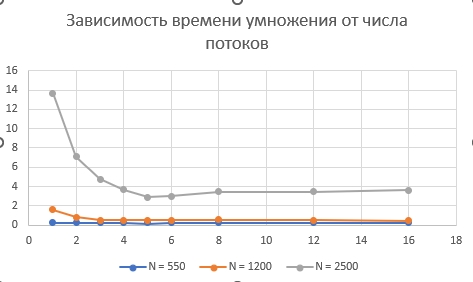
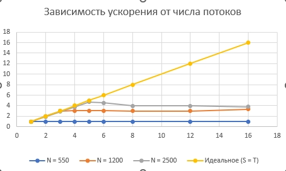

# Антипин Дмитрий Константинович, группа ИТ-7,8. — Лабораторная работа № 2. Многопоточное умножение матриц

Программа умножает две матрицы на языке C++ с помощью стандартных потоков (`std::thread`). Строки результирующей матрицы распределяются между потоками вручную. Во время вычисления отображается прогресс в процентах; после завершения выводятся чистое время умножения, контрольная сумма и сама матрица (если её размер не превышает `10 × 10`).

---

## Требования

* Компилятор с поддержкой **C++20** (Microsoft Visual Studio 2022 / MSVC `cl.exe` или `g++`).
* ОС Windows 10 (x64).
* Сторонние библиотеки не требуются.

---

## Структура проекта

```text
OS/
├── matmul.cpp          # Основной исходный код (генерация, многопоточное умножение, прогресс)
├── graph_time.png      # График зависимости времени умножения от числа потоков
├── graph_speedup.png   # График зависимости ускорения S(T) от числа потоков
└── README.md           # Отчёт и инструкция по сборке и запуску
```

---

## Сборка и запуск

### Через Visual Studio 2022
1. Откройте решение `OS.sln` в Visual Studio.
2. Выберите сверху конфигурацию **`Release`** и платформу **`x64`** (обязательно для включения оптимизаций компилятора).
3. Соберите проект (`Ctrl + Shift + B`) и запустите без отладки (`Ctrl + F5`).
4. Введите с клавиатуры 4 положительных целых числа через пробел и нажмите `Enter`:
   ```text
   2500 2500 2500 6
   ```

### Через командную строку (терминал)
Находясь в папке с исходным кодом, скомпилируйте программу с максимальной оптимизацией скорости:
```powershell
cl /O2 /std:c++17 /utf-8 /EHsc matmul.cpp /Fe:OS.exe
```

Запуск отдельного умножения (параметры можно передать сразу в аргументах командной строки):
```powershell
.\OS.exe 2500 2500 2500 6
```

**Параметры запуска (`n m k T`):**
* `n` - число строк матрицы `A`;
* `m` - число столбцов матрицы `A` и строк матрицы `B`;
* `k` - число столбцов матрицы `B`;
* `T` - число рабочих потоков.

Если `T > n`, программа автоматически ограничивает число рабочих потоков до `n`, чтобы не создавать простаивающие потоки.

### Автоматическая серия замеров (PowerShell)
Для воспроизведения серии из 135 замеров (3 размера матриц × 9 вариантов числа потоков × 5 повторов) выполните в папке с `OS.exe`:
```powershell
[Console]::OutputEncoding = [System.Text.Encoding]::UTF8
$sizes = @(550, 1200, 2500)
$threads = @(1, 2, 3, 4, 5, 6, 8, 12, 16)
foreach ($n in $sizes) {
    foreach ($t in $threads) {
        "=== N=$n, T=$t ===" | Out-File results.txt -Append -Encoding UTF8
        1..5 | ForEach-Object {
            .\OS.exe $n $n $n $t | Tee-Object -FilePath results.txt -Append
        }
    }
}
```

---

## Вывод программы и замер времени

Матрицы заполняются случайными целыми числами от `0` до `9` с фиксированным зерном генератора (`rng(42)`), чтобы результаты можно было сверять между запусками. Программа выводит:
* прогресс выполнения в процентах (обновляется отдельным потоком каждые 250 мс);
* время умножения в секундах;
* контрольную сумму всех элементов матрицы `C`;
* итоговую матрицу целиком, если `n <= 10` и `k <= 10`.

**Что входит в замер:** генерация матриц и подсчёт контрольной суммы **не входят** в измеряемое время. Таймер (`std::chrono::steady_clock`) замеряет только работу рабочих потоков, синхронизацию и ожидание их завершения (`join()`).

---

## 1. Среда выполнения

* **Процессор:** Intel Core i5-8400 (2.80 ГГц), **6 физических ядер / 6 логических потоков** (Hyper-Threading отсутствует).
* **Кэш L3:** 9,0 МБ.
* **Оперативная память (ОЗУ):** 16 ГБ DDR4.
* **Операционная система:** Windows 10 x64, версия 22H2, сборка 19045.6466.
* **Компилятор и флаги:** MSVC (`cl.exe`, Visual Studio 2022), конфигурация `Release`, `/O2 /std:c++20 /utf-8`.
* **Условия запуска:** замеры проводились на основной ОС (не в виртуальной машине), при питании от сети и закрытых фоновых программах.

---

## 2. Описание реализации

* **Хранение матриц и работа с кэшем:** матрицы `A`, `B` и `C` хранятся в одномерных векторах `std::vector<int64_t>` (доступ к элементу `(i, j)` по индексу `i * cols + j`). Во внутреннем цикле используется порядок `i -> t -> j`, чтобы читать строки матриц `B` и `C` последовательно по 64-байтным кэш-линиям.
* **Распределение строк между потоками:** активное число потоков равно `active_threads = std::min(n, num_threads)`. Каждый поток получает `base_rows = n / active_threads` строк, а первые `n % active_threads` потоков берут по одной дополнительной строке. Матрицы `A` и `B` передаются по константной ссылке (`std::cref`) без копирования памяти.
* **Счётчик прогресса и синхронизация:** каждый поток пишет ответы только в свой непересекающийся блок строк матрицы `C`, поэтому для самой матрицы мьютексы не нужны. Общий счётчик готовых строк `std::atomic<int> completed_rows` защищён атомарным инкрементом `fetch_add(1)`. Без `std::atomic` одновременное изменение обычной переменной `int` вызвало бы гонку данных (потерю части прибавлений `+1`), из-за чего прогресс не дошёл бы до 100%.

### Ключевые фрагменты кода

**Функция рабочего потока (`MultiplyWorker`):**
```cpp
void MultiplyWorker(const std::vector<int64_t>& A, const std::vector<int64_t>& B,
                    std::vector<int64_t>& C, int start_row, int end_row,
                    int m, int k, std::atomic<int>& completed_rows) {
    for (int i = start_row; i < end_row; ++i) {
        const int row_offset_a = i * m;
        const int row_offset_c = i * k;
        for (int t = 0; t < m; ++t) {
            const int64_t a_val = A[row_offset_a + t];
            const int row_offset_b = t * k;
            for (int j = 0; j < k; ++j) {
                C[row_offset_c + j] += a_val * B[row_offset_b + j];
            }
        }
        completed_rows.fetch_add(1, std::memory_order_relaxed);
    }
}
```

**Поток вывода прогресса (`ProgressMonitor`):**
```cpp
void ProgressMonitor(const std::atomic<int>& completed_rows,
                     int total_rows, std::atomic<bool>& done) {
    int last_percent = -1;
    while (!done.load(std::memory_order_acquire)) {
        int current = completed_rows.load(std::memory_order_relaxed);
        int percent = (total_rows > 0) ? (current * 100 / total_rows) : 100;
        if (percent != last_percent && percent < 100) {
            std::cout << "\rПрогресс: " << percent << "%" << std::flush;
            last_percent = percent;
        }
        std::this_thread::sleep_for(std::chrono::milliseconds(250));
    }
    std::cout << "\rПрогресс: 100%" << std::endl;
}
```

---

## 3. Тестирование корректности

Перед замерами производительности программа прошла проверку по четырём группам тестов:

| № | Сценарий проверки | Входные данные | Ожидаемый результат | Фактический результат |
| :-: | :--- | :--- | :--- | :--- |
| 1 | **Ручная сверка математики** (прямоугольные матрицы, неделимое число строк) | `3 4 2 2` (матрица $3\times4$ на $4\times2$, 2 потока: 2 строки 1-му потоку, 1 строка 2-му) | Точное совпадение каждого элемента матрицы `C` с ручным расчётом | Выведена полная матрица `C`, все 6 элементов и контрольная сумма совпали |
| 2 | **Избыточное число потоков** (`T > n`) | `3 3 3 16` | Создание только 3 рабочих потоков (`std::min(3, 16)`), корректный ответ без ошибок памяти | Программа отработала штатно, контрольная сумма совпала с запуском при `T = 1` |
| 3 | **Граничные и ошибочные значения** | `1 1 1 4` и `0 5 5 2` | Для `1×1` — произведение двух чисел; при `0` — сообщение об ошибке и выход с кодом `1` | На `1×1` выдан точный результат; на `0` программа корректно завершилась с кодом `1` |
| 4 | **Инвариантность в многопоточности** (отсутствие гонок данных) | `N ∈ {550, 1200, 2500}`, `T ∈ {1..16}` (всего 135 запусков) | Одинаковая контрольная сумма при любом числе потоков `T` для одного размера `N` | `3375946312` (`N=550`), `35009903832` (`N=1200`), `316556608800` (`N=2500`) — 100% совпадение |

---

## 4. Методика и результаты экспериментов

Размеры матриц выбраны относительно объёма L3-кэша процессора Intel Core i5-8400 (9,0 МБ):
* `550 × 550` (~7,3 МБ) — помещается в L3-кэш;
* `1200 × 1200` (~34,5 МБ) — больше L3-кэша;
* `2500 × 2500` (~150 МБ) — работает через оперативную память (~13,7 с на 1 потоке).

Для каждого размера и каждого числа потоков `T ∈ {1, 2, 3, 4, 5, 6, 8, 12, 16}` сделано **5 замеров**. Наименьшее и наибольшее значения отбрасывались, по оставшимся 3 считалось среднее время $t(T)$. Ускорение: $S(T) = t(1) / t(T)$, эффективность: $E(T) = S(T) / T$.

### Матрица 550 × 550 (контрольная сумма: `3375946312`)

| Потоки (T) | Среднее время, с | Ускорение S(T) | Эффективность E(T) |
| :---: | :---: | :---: | :---: |
| 1 | 0.2602 | 1.00 | 1.00 |
| 2 | 0.2595 | 1.00 | 0.50 |
| 3 | 0.2597 | 1.00 | 0.33 |
| 4 | 0.2602 | 1.00 | 0.25 |
| 5 | 0.2591 | 1.00 | 0.20 |
| 6 | 0.2608 | 1.00 | 0.17 |
| 8 | 0.2608 | 1.00 | 0.12 |
| 12 | 0.2595 | 1.00 | 0.08 |
| 16 | 0.2594 | 1.00 | 0.06 |

### Матрица 1200 × 1200 (контрольная сумма: `35009903832`)

| Потоки (T) | Среднее время, с | Ускорение S(T) | Эффективность E(T) |
| :---: | :---: | :---: | :---: |
| 1 | 1.5738 | 1.00 | 1.00 |
| 2 | 0.7853 | 2.00 | 1.00 |
| 3 | 0.5226 | 3.01 | 1.00 |
| 4 | 0.5205 | 3.02 | 0.76 |
| 5 | 0.5211 | 3.02 | 0.60 |
| 6 | 0.5218 | 3.02 | 0.50 |
| 8 | 0.5260 | 2.99 | 0.37 |
| 12 | 0.5223 | 3.01 | 0.25 |
| 16 | 0.4688 | 3.36 | 0.21 |

### Матрица 2500 × 2500 (контрольная сумма: `316556608800`)

| Потоки (T) | Среднее время, с | Ускорение S(T) | Эффективность E(T) |
| :---: | :---: | :---: | :---: |
| 1 | 13.6723 | 1.00 | 1.00 |
| 2 | 7.1042 | 1.92 | 0.96 |
| 3 | 4.7345 | 2.89 | 0.96 |
| 4 | 3.6778 | 3.72 | 0.93 |
| 5 | 2.8899 | 4.73 | 0.95 |
| 6 | 3.0106 | 4.54 | 0.76 |
| 8 | 3.4622 | 3.95 | 0.49 |
| 12 | 3.4519 | 3.96 | 0.33 |
| 16 | 3.5851 | 3.81 | 0.24 |

### Графики





---

## 5. Анализ результатов

* **Оптимальное число потоков:** на 6-ядерном процессоре Intel Core i5-8400 (без Hyper-Threading) оптимально использовать **5–6 потоков**. На матрице `2500 × 2500` пик скорости достигается на 5 потоках (2,89 с, ускорение **4,73×**), а на 6 потоках время чуть выше (3,01 с, ускорение **4,54×**), так как одно из ядер делится с Windows и потоком вывода прогресса.
* **Почему ускорение меньше идеального (`6.0×`):** сказываются расходы на запуск потоков, снижение частоты Turbo Boost при одновременной нагрузке на все ядра и общая очередь к оперативной памяти.
* **Что происходит при `T > 6` (8, 12, 16 потоков):** ускорение падает с 4,73× до 3,81× (время растёт до 3,59 с). Ядер всего 6, поэтому ОС вынуждена постоянно переключать контекст между потоками, тратя процессорное время и вымывая данные из кэша.
* **Влияние размера матрицы и памяти:** матрица `2500 × 2500` занимает ~150 МБ (в 16 раз больше L3-кэша 9 МБ), поэтому на 5–6 ядрах скорость упирается в пропускную способность оперативной памяти.
* **Почему на матрицах `550` и `1200` график упёрся в ровную полку (`0,26 с` и `0,52 с`):** в потоке `ProgressMonitor` стоит пауза `sleep_for(250 ms)`. Когда рабочие потоки на 3–6 ядрах заканчивают счёт быстрее чем за 0,25 с (для `550`) или за два интервала сна (для `1200`), программа ждёт завершения `ProgressMonitor` в `join()`. На матрице `2500 × 2500` задержка 0,25 с почти незаметна на фоне 3 секунд счёта.

---

## 6. Выводы

1. Реализовано многопоточное умножение матриц на C++ (`std::thread`) с безопасным подсчётом прогресса через `std::atomic<int>` и кэш-дружественным порядком циклов `i -> t -> j`.
2. Проведена комплексная проверка корректности (ручная сверка на прямоугольных матрицах, граничные случаи `T > n` и `1×1`, инвариантность контрольной суммы на всех 135 запусках).
3. Эксперименты на 6-ядерном Intel Core i5-8400 подтвердили, что максимальное ускорение (**4,73×**) достигается на 5–6 потоках, а дальнейшее увеличение числа потоков снижает производительность из-за переключений контекста ОС.
4. На больших матрицах (`2500 × 2500`) скорость ограничивается пропускной способностью оперативной памяти, а на малых (`550 × 550`) минимальное время упёрлось в шаг сна потока прогресса (`250 мс`).
